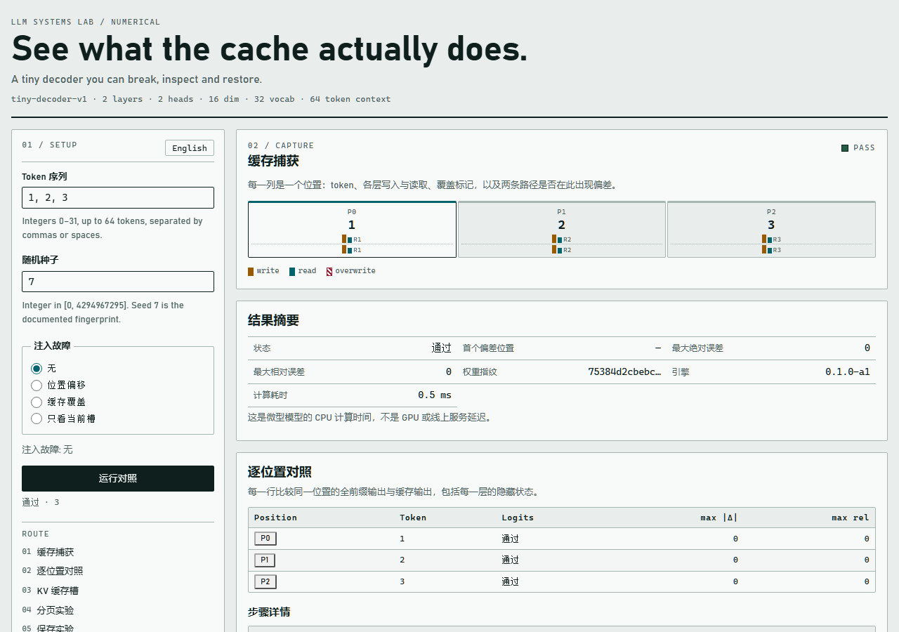
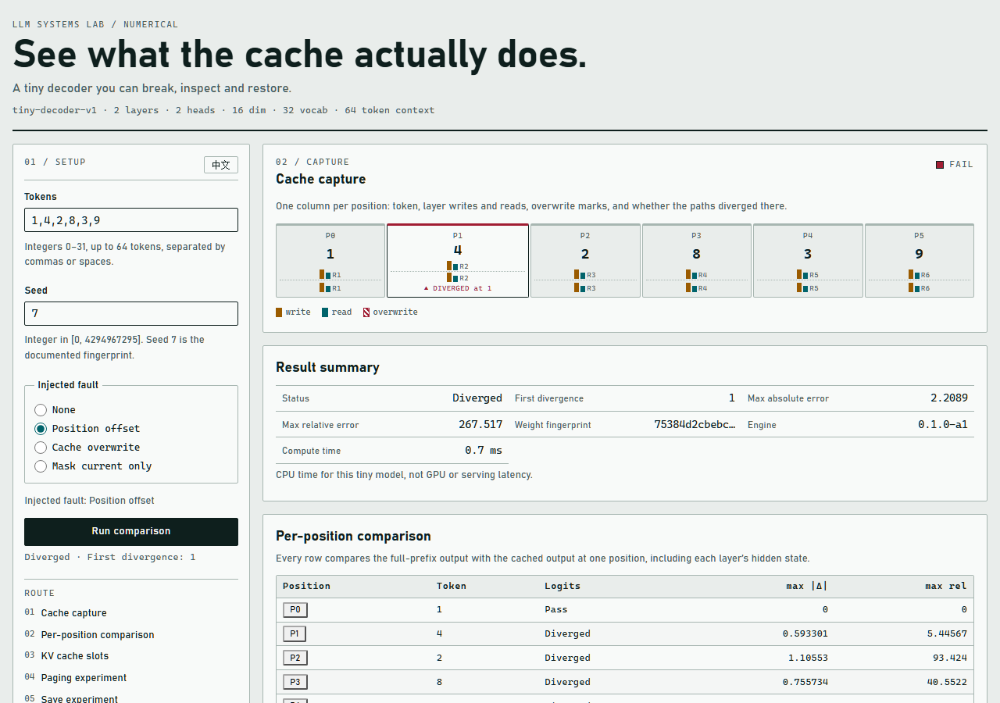
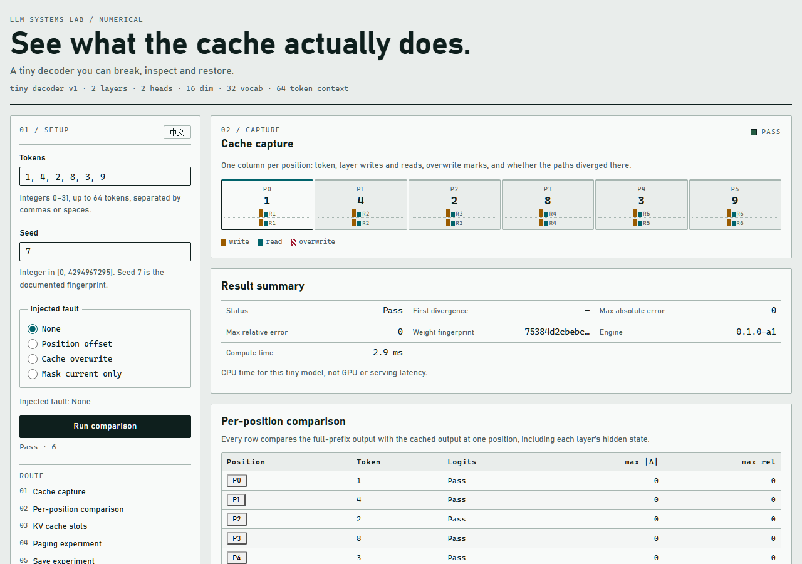
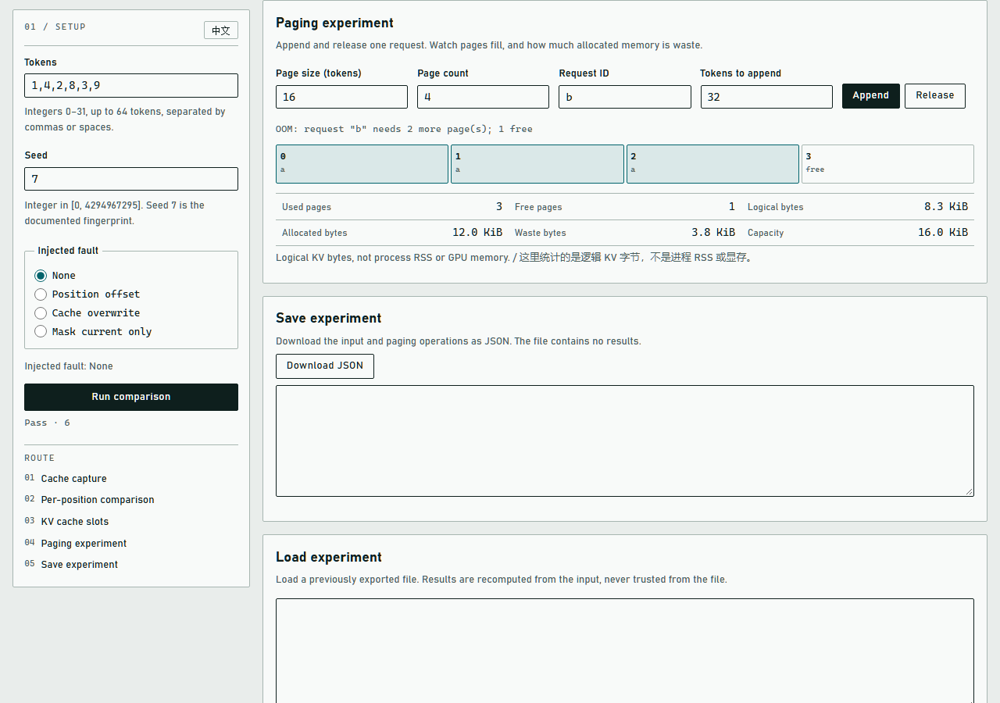

# llm-systems-lab

**把“数值正确性”变成可执行证据的小型 LLM 推理系统实验室。**

[中文](#中文) · [English](#english)

---

## 中文

### 这个项目是什么

`llm-systems-lab` 用一个小到可以逐行读懂的 decoder（2 层、2 头、隐藏维 16、词表 32、上下文 64），把 LLM 推理里最容易“看起来对、其实错”的三件事连成一个可复现的验收闭环：

1. **数值语义**：TypeScript 实现必须与一份独立的 Python/NumPy 参考实现在 130 个保留用例上逐元素一致（logits、每层 hidden、每层 KV cache）。
2. **KV cache**：同一个模型分别走“全前缀重算”和“增量缓存”两条路径，逐位置比较；容差是固定契约，不是事后调出来的。
3. **故障注入**：三种教学故障只注入缓存路径。验收要求正常路径通过，且每种故障都在第 1 个非零位置之后被抓住。

此外提供一个**纯逻辑**的 KV 分页模拟器（按页分配、最低空闲页优先、OOM 原子失败），用于解释分页浪费与碎片，不冒充真实 GPU 测量。

### 当前状态：A3 公开测试版

已完成：

- 冻结的数值契约与确定性权重生成
- 全前缀路径、增量缓存路径、逐位置比较
- 三种故障注入
- 130 用例的独立 NumPy 参考 fixture
- CLI：`run` / `replay` / `demo`
- 源代码变异检查：6 个变异体全部被指定测试抓住
- A2 浏览器教学界面：逐位置 capture bar、步骤详情、KV cache 槽位、单请求分页实验、实验文档导出/导入、中英切换、键盘操作、窄屏与减弱动画
- `scripts/verify.mjs` 八阶段总验收：构建、Web 构建、TypeScript 测试、Web 测试、Python 参考测试、fixture 溯源、变异检查、打包冒烟
- A3 发布准备：MIT 许可证、CI 与 GitHub Pages 工作流、真实界面截图（仓库与在线演示链接在发布后补充）

尚未包含：真实 GPU 显存/吞吐测量、训练或模型质量评估、真实用户测试或用户研究。本项目**不**声称模型能力、性能、视觉质量或学习效果有任何优势。

### 界面截图

截图来自真实构建（headless Edge 157，1280×900），不是 mockup；环境与限制见下方“限制”。




### 快速开始

要求 Node.js >= 22.18.0。只有运行 Python 参考测试时才需要 Python 3 + NumPy；浏览器 E2E 需要本机已安装 Edge 或 Chrome。

```bash
npm install
npm run build
npm test                     # 93 个测试，含 130 用例跨语言参考比对

# 人读演示：正常路径通过，三种故障都在 position 1 被抓到
node dist/src/cli.js demo

# 构建并打开静态教学界面（两个终端）
node scripts/build-web.mjs
node scripts/serve-web.mjs   # http://127.0.0.1:4173

# 浏览器端 E2E：15 个场景，使用隔离的临时浏览器配置
npm run e2e:web
```

`demo` 的实际输出：

```text
llm-systems-lab 0.1.0-a1 numerical demo
model: tiny-decoder-v1 (untrained, deterministic weights)
case: seed=7 tokens=1,4,2,8,3,9
method: compare the full-prefix path against the cached path at every position
normal: PASS (firstDivergence=null)
position-offset: DIVERGED at position 1
cache-overwrite: DIVERGED at position 1
mask-current-only: DIVERGED at position 1
result: PASS (numerical path only; not model quality, speed, or GPU memory)
```

命令行接口：

```bash
# 输出一行稳定 JSON；数值一致退出 0，出现偏差退出 1，参数/输入错误退出 2
node dist/src/cli.js run --seed 7 --tokens 1,4,2,8,3,9
node dist/src/cli.js run --seed 7 --tokens 1,4,2,8,3,9 --fault cache-overwrite

# 把报告落盘，再从 input 重新计算并复验（不信任报告里记录的 steps）
node dist/src/cli.js run --seed 7 --tokens 1,4,2 > report.json
node dist/src/cli.js replay report.json
```

`replay` 只接受不超过 1 MiB 的普通文件，并校验 `schemaVersion`、`engineVersion`、模型 ID、权重指纹和输入形状；记录的结果字段会被重新计算覆盖。

### 浏览器教学界面

界面是 `apps/web/dist` 里的纯静态文件，由 `scripts/serve-web.mjs` 以只读方式提供；没有服务器端应用、外部字体、CDN、统计脚本或运行时依赖，除本机静态服务器外不发起任何网络请求，断网也能使用。

一条教学路线覆盖：

1. **逐位置 capture bar**：每个位置显示 token，以及两层各自的写入/读取标记与读取次数；发生偏差时标出第一个分歧位置。
2. **步骤详情**：该位置的 logits、每层 hidden state，以及每次 cache 事件（写入、读取、覆盖）。
3. **KV cache 槽位视图**：两层各自的槽位状态，区分已写、已读、被覆盖。
4. **单请求分页实验**：追加/释放请求，观察页占用、逻辑字节、已分配字节与浪费字节；OOM 原子失败，不产生部分分配。
5. **实验文档**：导出的 JSON 只含输入与分页操作，不含结果；导入时重新计算，并拒绝未知字段、超限文档和无效分页操作。

界面限制：最多 64 个 token、导入文档最多 256 KiB、分页操作日志最多 1000 条（实时操作与导入文档使用同一上限）。界面文案以英文为主，可切换中文；解释区始终同时给出中英文。所有动态文本使用 `textContent`，导入数据不会作为 HTML 执行。页内显示的耗时是 JavaScript 计算时间，不是 GPU 时间。

### 数值契约

| 项目 | 值 |
|---|---|
| 词表 / 上下文 | 32 / 64 |
| 层数 / 头数 / 每头维度 | 2 / 2 / 8 |
| 模型维度 / FFN 维度 | 16 / 32 |
| LayerNorm epsilon | 1e-5 |
| 权重存储 | float32 |
| 累加精度 | float64 |
| 比较容差 | `|a - r| <= 1e-5 + 1e-4 * |r|` |

模型没有 bias、dropout、weight tying 或 RoPE；权重由固定 LCG 从 seed 生成，因此同一 seed 在任何机器上都得到同一组 float32 权重。权重指纹是对固定顺序的小端 float32 字节做 SHA-256。

**这不是训练项目。** 权重未训练，数值一致性验证的是系统语义，不是模型质量。

### 三种教学故障

| 故障 | 缓存路径中的行为 | 模拟的真实缺陷 |
|---|---|---|
| `none` | 正确路径 | 基线 |
| `position-offset` | 位置 0 之后读取 `(pos + 1) mod 64` 的位置嵌入 | 位置编码差一 |
| `cache-overwrite` | 位置 0 之后、追加前先覆盖 0 号槽的 K/V | 槽位别名 / 环形缓冲越界 |
| `mask-current-only` | 注意力只能看到最新一个槽 | 因果掩码或窗口写错 |

三种故障在 position 0 与正确路径完全相同，因此验收必须看到 `firstDivergence >= 1`；只在第 0 步比较的实现会漏掉全部三种故障。

### 独立参考与 fixture

- `reference/decoder.py`：不共享 TypeScript 代码的 NumPy 实现，使用 float32 物化、float64 矩阵乘累加。
- `reference/generate_cases.py`：生成 130 个保留用例，覆盖多个 seed、64 token 满上下文、重复 token 与边界 token。
- `tests/fixtures/reference.json`：已检入的期望输出（logits、每层 hidden、每层 K/V cache），fixture SHA-256 为
  `7f41810d41d84e3e10966bf343350c3de144bd7b4d51db7b9e600e66f5637020`。
- fixture 的 `provenance` 记录生成器与解码器的 SHA-256；`scripts/verify.mjs` 会重新计算磁盘上的源码哈希并比对。

测试只读取已检入的 fixture，不在测试运行时重算期望答案，避免“用被测实现证明被测实现”。

### KV 分页模拟器

```js
import { PagePool } from './dist/packages/simulator/index.js';

const pool = new PagePool(16, 4); // 每页 16 token，共 4 页
pool.append('a', 32);             // 2 页
pool.append('a', 1);              // 需要第 3 页
const snapshot = pool.snapshot();

snapshot.requests[0].pages; // [0, 1, 2]
snapshot.wasteTokens;       // 15
snapshot.wasteBytes;        // 3840
```

每个 token 的理论 KV 负载是 256 字节：2（K 和 V）× 2 层 × 2 个 KV 头 × 8 维 × 4 字节。这是教学记账单位，不是进程 RSS，也不是实测显存。分配按最低空闲页优先；容量不足时抛 `OOM`，且不产生任何部分分配。

### 验证链

```bash
python -m unittest discover -s reference -p "test_*.py"   # 18 个 NumPy 自测
node scripts/mutation-check.mjs                           # 6/6 变异体被抓住
node scripts/verify.mjs                                   # 八阶段串行总验收
npm run e2e:web                                           # 15 个浏览器场景
```

`scripts/verify.mjs` 依次执行八步，任何一步失败、组件缺失或退出码非零都会让总验收失败，而不是跳过：

1. TypeScript 构建
2. Web 构建：编译浏览器代码，校验 2 MiB 预算、HTML shell 中必需的 CSP 指令与无绝对 URL（这是必需的指令级检查，不是“CSP 无法被削弱”的穷举证明；同源与无控制台错误由浏览器 E2E 单独断言）
3. 全部 TypeScript 测试（串行，93 个）
4. Web 测试（3 个文件、17 个用例；零文件或数量下降都会失败）
5. Python 参考自测
6. fixture 溯源（源码哈希、模型 ID、schema、用例数）
7. 源代码变异检查
8. `npm pack` 打包冒烟：解包到全新目录，在没有源码和 Python 的环境里运行 CLI，并检查 tarball 只含 `package.json`、`README.md`、`LICENSE` 与 `dist/`

总验收只在结果确定后写 `artifacts/verify-receipt.json`（已忽略），记录各步骤结果、哈希，以及 `web: { bytes, files, tests }`。负向对照：`WEB_MAX_BYTES=1 node scripts/verify.mjs` 必须在 web-build 阶段失败。

变异检查不是覆盖率数字：每个变异体必须在构建成功后让**指定的测试**失败。例如：

- 关掉 `cache-overwrite` 分支 → 指定的 decoder 测试必须失败
- 把分页的 `Math.ceil` 改成 `Math.floor` → 指定的 paging 测试必须失败
- 把比较结果硬编码成 `passes: true` → 指定的 experiment 测试必须失败

变异执行器本身也有测试，覆盖 CAUGHT、MISSED、NOP、BUILD-FAIL、WRONG-FAILURE、目标不唯一和目标不存在等情况。

### 仓库结构

```text
packages/contracts/   输入验证、模型规格、错误类型
packages/core/        权重、数学、decoder、实验与 replay
packages/simulator/   分页记账模拟器
apps/web/             静态教学界面（TypeScript + 原生 DOM，无框架）
src/cli.ts            run / replay / demo
reference/            独立的 NumPy 实现与 fixture 生成器
tests/                TypeScript / Web 测试与 130 用例 fixture
scripts/              构建、静态服务器、E2E、变异检查、总验收
docs/                 数值契约与实施计划
```

### 限制

- 权重未训练，不评估模型质量、准确率或下游能力。
- 故障注入是教学与验收工具，不是生产级缓存实现。
- 分页数字是逻辑字节记账，不是 CUDA / 驱动 / 进程层面的实测。
- 浏览器证据来自 Windows 上的 headless Edge：未在 Firefox/Safari、真实手机或读屏软件上验证，也没有用户研究；不声称视觉质量或学习效果。
- Web 构建的 CSP 检查只核对 HTML shell 里必需的指令是否在场，不证明策略无法被后续改动削弱；绝对 URL 检查也只覆盖 shell 的 `src`/`href`。加载资源的同源性与控制台无错误由浏览器 E2E 的 resources 场景独立验证。
- 界面里的耗时是 JavaScript 计算时间，不是 GPU 时间或吞吐。
- 1.0 之前 CLI 与导出接口可能变化。
- 130 个用例是回归证据，不是对所有输入数值正确性的数学证明。

### 许可证

MIT，见 [LICENSE](LICENSE)。

### 反馈与贡献

公开测试版的反馈入口是 GitHub Issues；提交前请阅读 [CONTRIBUTING.md](CONTRIBUTING.md)。请勿在 Issue 中粘贴秘密、私有数据或本机个人路径。

---

## English

### What it is

`llm-systems-lab` is a deliberately small decoder (2 layers, 2 heads, hidden size 16, vocabulary 32, context 64) that turns numerical correctness of LLM inference into executable evidence:

1. **Numerical semantics** — the TypeScript implementation must match an independent Python/NumPy reference element by element on 130 reserved cases: logits, every layer's hidden states, and every layer's K/V cache.
2. **KV cache** — the same model is run through a full-prefix path and an incremental cached path, then compared at every position under a frozen tolerance.
3. **Fault injection** — three teaching faults are injected only into the cached path. Acceptance requires the normal path to pass and every fault to be caught after the first non-zero position.

A pure-accounting KV paging simulator (lowest-free-page allocation, atomic OOM failure) is included to explain paging waste. It does not pretend to measure real GPU memory.

### Status: A3 public beta

Implemented: frozen numerical contract, deterministic weights, full and cached paths, three faults, a 130-case independent fixture, the `run` / `replay` / `demo` CLI, a six-mutant source mutation check, and a static browser lab with a per-position capture bar, step detail, KV cache slots, a single-request paging experiment, experiment export/import, English/Chinese chrome, keyboard operation, narrow layout and reduced motion. The serial `scripts/verify.mjs` gate now has eight stages, including the web build and web tests. A3 release preparation adds the MIT license, CI and GitHub Pages workflows, and real UI screenshots; repository and live-demo links are added after publication.

Not included: training or model-quality evaluation, real GPU memory/throughput measurement, real user testing or user studies. The project makes no claim of model quality, speed, visual quality or learning effectiveness.

### Screenshots

Real build, headless Edge 157 at 1280×900; not mockups. Environment and limits are listed under Limitations.




### Quick start

```bash
npm install
npm run build
npm test                     # 93 tests, including the 130-case cross-language comparison
node dist/src/cli.js demo
node dist/src/cli.js run --seed 7 --tokens 1,4,2,8,3,9
node dist/src/cli.js run --seed 7 --tokens 1,4,2,8,3,9 --fault cache-overwrite
python -m unittest discover -s reference -p "test_*.py"
node scripts/verify.mjs

# Static teaching lab (two terminals); requires Edge or Chrome for E2E
node scripts/build-web.mjs
node scripts/serve-web.mjs   # http://127.0.0.1:4173
npm run e2e:web              # 15 browser scenarios, isolated temporary browser profile
```

`run` prints one line of stable JSON and exits 0 on numerical agreement, 1 on divergence, and 2 on invalid input. `replay` re-runs the recorded input, ignores recorded step results, and verifies the weight fingerprint.

### The browser lab

`apps/web/dist` is a plain static bundle served read-only by `scripts/serve-web.mjs`. There is no server-side application, external font, CDN, analytics or runtime dependency; apart from the local static server it makes no network requests, and it keeps working without internet access.

One teaching route covers:

1. **Per-position capture bar** — every position shows its token and each layer's own write/read marks with the read count; the first divergence is flagged.
2. **Step detail** — logits, both layers' hidden states, and every cache event (write, read, overwrite) for the selected position.
3. **KV cache slots** — two layer grids distinguishing written, read and overwritten slots.
4. **Single-request paging** — append and release a request, and read used pages, logical bytes, allocated bytes and waste. OOM is atomic and leaves no partial allocation.
5. **Experiment document** — the exported JSON contains the input and paging operations but no results; import recomputes everything and rejects unknown keys, oversized documents and invalid operations.

UI limits: at most 64 tokens, a 256 KiB import limit, and a 1000-operation paging log shared by live edits and imported documents. Chrome is English-first with a Chinese toggle; the explanation block is always shown in both languages. Dynamic text uses `textContent`, so imported data is never executed as HTML. Timings shown in the page are JavaScript compute time, not GPU time.

### Contract

Vocabulary 32, context 64, 2 layers, 2 heads, head dimension 8, model dimension 16, FFN dimension 32, LayerNorm epsilon 1e-5. Weights are float32, accumulation is float64, and comparison uses `|a - r| <= 1e-5 + 1e-4 * |r|`. Weights come from a fixed LCG, so a seed identifies the same float32 weights everywhere; the fingerprint is SHA-256 over little-endian float32 bytes in a fixed order. The weights are untrained: this validates system semantics, not model quality.

### Faults

| Fault | Cached-path behavior | Real bug it models |
|---|---|---|
| `none` | correct path | baseline |
| `position-offset` | reads positional embedding `(pos + 1) mod 64` after position 0 | off-by-one positions |
| `cache-overwrite` | overwrites slot 0 K/V before appending after position 0 | slot aliasing / ring-buffer overflow |
| `mask-current-only` | attends only to the newest slot | broken causal mask or window |

All three are identical to the correct path at position 0, so detection must show `firstDivergence >= 1`.

### Independent reference

`reference/decoder.py` is an independent NumPy implementation. `reference/generate_cases.py` produced the checked-in fixture (`tests/fixtures/reference.json`, SHA-256 `7f41810d41d84e3e10966bf343350c3de144bd7b4d51db7b9e600e66f5637020`) with 130 reserved cases, including full 64-token contexts and repeated tokens. Tests never regenerate expected answers at test time. The fixture records source digests, and `scripts/verify.mjs` recomputes them from disk.

### Verification

`scripts/verify.mjs` runs eight stages serially: build, web build, TypeScript tests (93), web tests (17 across three files), Python reference tests, fixture provenance, a six-mutant source-mutation check, and a packed-artifact smoke test. The web build asserts the 2 MiB budget, the required CSP directives in the HTML shell, and the absence of absolute URLs in that shell; it is a required-directive check, not a proof that the policy cannot be weakened later, and the browser E2E separately asserts that every loaded resource is same-origin and that the console is error-free. Web tests fail closed if no web test file exists or the count drops. Missing components or non-zero exits fail the gate; nothing is silently skipped. Mutants count only when the build succeeds and a named test fails. The mutation runner has its own tests covering CAUGHT, MISSED, NOP, BUILD-FAIL, WRONG-FAILURE, non-unique targets, and missing targets. Negative control: `WEB_MAX_BYTES=1 node scripts/verify.mjs` must fail at the web-build stage.

### Limitations

Untrained weights; no accuracy or downstream capability claims. Fault injection is teaching instrumentation, not a production cache. Paging numbers are logical byte accounting, not measured VRAM. Browser evidence comes from headless Edge on Windows: Firefox/Safari, real phones, screen readers and user studies were not exercised, and no visual-quality or learning-effect claim is made. Timings in the page are JavaScript compute time, not GPU time. The web build's CSP check verifies that the required directives are present in the HTML shell; it does not prove the policy cannot be weakened by later edits, and its absolute-URL check only covers the shell's `src`/`href`. Resource same-origin and console cleanliness are asserted by the browser E2E resources section. The 130 cases are regression evidence, not a proof of numerical correctness for all inputs.

### License

MIT. See [LICENSE](LICENSE).

### Feedback and contributions

Use GitHub Issues for public-beta feedback; read [CONTRIBUTING.md](CONTRIBUTING.md) first. Do not paste secrets, private data or personal paths into an issue.
